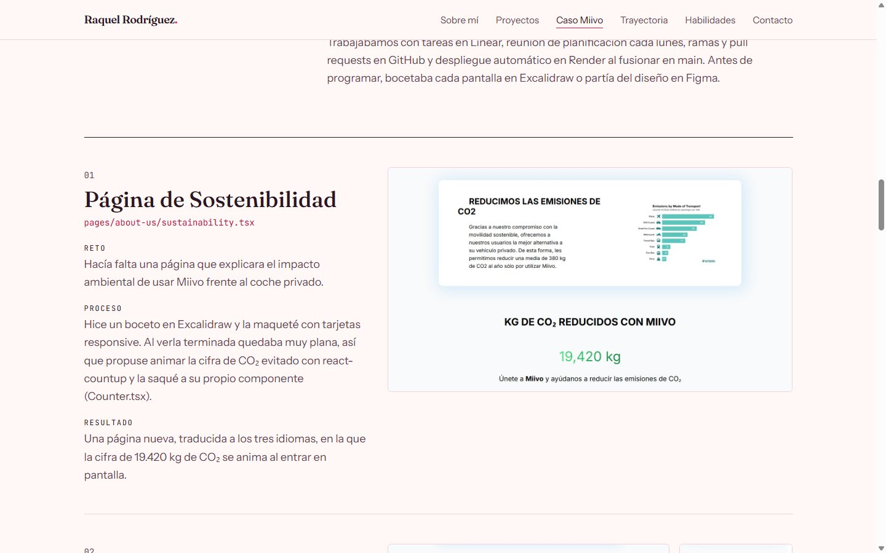
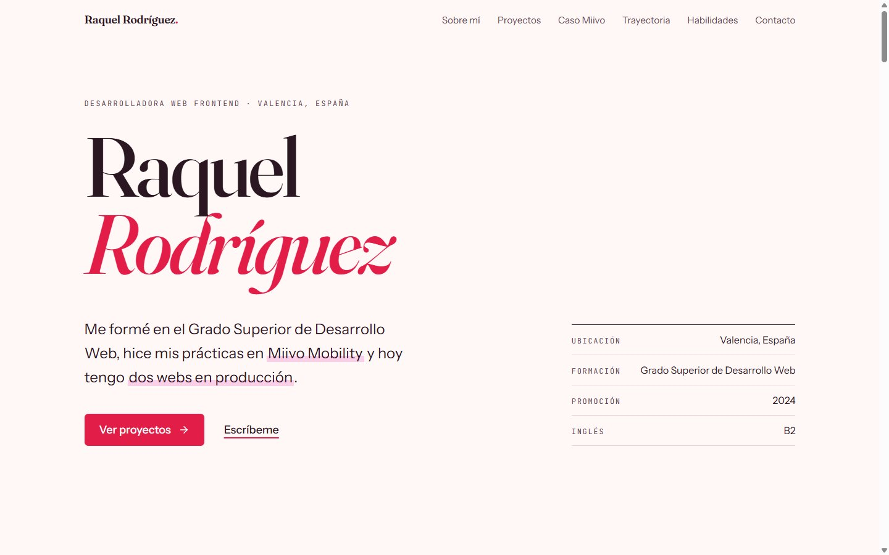
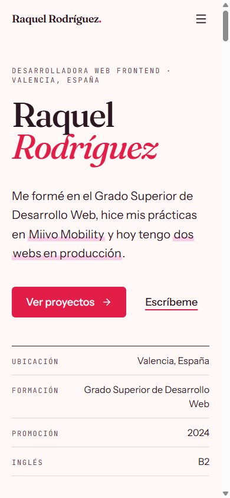

# 💜 Portfolio - Raquel Rodríguez

Portfolio personal desarrollado con React y Tailwind CSS, mostrando mis proyectos, mi experiencia y mis habilidades como desarrolladora web frontend.


## 🌟 Características

- ✍️ Diseño editorial: tipografía serif (Fraunces) para los títulos, Instrument Sans para el texto y JetBrains Mono para los detalles
- 🎨 Paleta propia en tonos rosa y ciruela, definida en `tailwind.config.js`
- 📱 Totalmente responsive (mobile, tablet, desktop) con menú móvil
- 🧭 Navegación fija que marca la sección en la que estás
- 📂 Caso de estudio de mis prácticas en Miivo, con capturas reales de escritorio y móvil
- ♿ Accesible: enlace «Saltar al contenido», foco visible con teclado, textos alternativos y respeto a la preferencia de reducir movimiento

## 🛠️ Tecnologías utilizadas

- **React 19** - Librería de interfaces
- **Tailwind CSS** - Framework de estilos
- **Lucide React** - Librería de iconos
- **Fontsource** - Fuentes autoalojadas
- **Create React App** - Entorno de desarrollo y build

## 📋 Secciones

1. **Inicio** - Presentación y datos principales
2. **Sobre mí** - Información personal y profesional
3. **Proyectos** - Webs y apps, empezando por KIRA (app Android y su web)
4. **Caso de estudio: Miivo** - Lo que hice en mis prácticas: páginas, secciones, retos y aprendizajes
5. **Trayectoria** - Experiencia y formación
6. **Habilidades** - Tecnologías con las que trabajo
7. **Contacto** - Email, solicitud de CV y LinkedIn

## 📂 Caso de estudio: Miivo

Durante mis prácticas en [Miivo](https://miivomobility.com), una startup valenciana de movilidad sostenible, desarrollé parte de su web con Next.js, React, TypeScript y Tailwind CSS. En el portfolio cuento cuatro piezas con su reto, proceso y resultado:

- **Página de Sostenibilidad**, con un contador animado de CO₂ reducido
- **Sección «Miivo en datos»** en la portada
- **Carrusel de medios de transporte**
- **Página de la API**, incluida una sección que propuse yo



> Miivo cerró y el código de su web está en un repositorio privado. Si quieres verlo, escríbeme y te doy acceso.

## 🚀 Instalación y uso

### Prerrequisitos

- Node.js (v18 o superior)
- npm

### Pasos para ejecutar localmente

1. Clona el repositorio
```bash
git clone https://github.com/raquelscommits/portfolio-raquel.git
```

2. Entra a la carpeta del proyecto
```bash
cd portfolio-raquel
```

3. Instala las dependencias
```bash
npm install
```

4. Ejecuta el proyecto en modo desarrollo
```bash
npm start
```

5. Abre tu navegador en `http://localhost:3000`

## 📦 Build para producción

Para crear una versión optimizada para producción:

```bash
npm run build
```

Los archivos se generarán en la carpeta `build/`

## 🎨 Personalización

Todo el contenido está en un solo archivo: `src/data/content.js`.

1. **Datos personales**: `person` y `facts`
2. **Proyectos**: el array `projects` (cada proyecto admite una imagen, un estado y una nota opcionales)
3. **Caso de estudio**: el objeto `miivoCase`; las capturas están en `public/images/miivo/`
4. **Trayectoria**: el array `experience`
5. **Habilidades**: el array `skillGroups`
6. **Enlaces**: el array `links`
7. **Colores y tipografías**: `tailwind.config.js`

## 📱 Capturas de pantalla

### Vista Desktop


### Vista Mobile


## 👩‍💻 Sobre mí

Desarrolladora web graduada en el Grado Superior de Desarrollo Web, especializada en frontend. Apasionada por crear experiencias web modernas y funcionales.

## 📫 Contacto

- **Email**: raquelrodrim2000@gmail.com
- **LinkedIn**: [linkedin.com/in/raquelrodrim](https://www.linkedin.com/in/raquelrodrim/)
- **GitHub**: [github.com/raquelscommits](https://github.com/raquelscommits)

## 📄 Licencia

Este proyecto es de uso personal. Siéntete libre de usar el código como inspiración para tu propio portfolio.

---

⭐ Si te gustó este proyecto, ¡dale una estrella en GitHub!

Hecho con 💜 por Raquel Rodríguez
